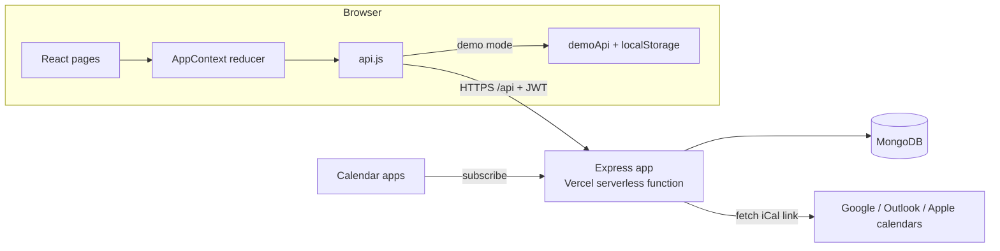

# Architecture

## How it works
- **React SPA (Vite).** Pages: Landing, Today (Dashboard), Calendar, Routines, Tasks, Goals, Settings, Login/Signup. App state lives in a React context (`AppContext`) with a reducer; every change updates the UI first, then calls the API.
- **API client (`src/utils/api.js`).** All requests go through one function. In demo mode it routes them to an in-browser mock API (`src/demo/demoApi.js`) backed by `localStorage` instead of the network.
- **Express API (`server/app.js`).** REST routes under `/api`: auth, tasks, goals, routines, completions, settings, focus-sessions, calendar. JWT middleware protects everything except auth and the public calendar feed. The same Express app runs locally (`server/index.js`) and on Vercel as a serverless function (`api/[...path].js`).
- **MongoDB (Mongoose).** Models: User, Routine, Completion, Task, Goal, FocusSession, Settings. The connection is reused across requests.
- **Calendar.** Import: the server fetches a user's private iCal link and parses it with node-ical. Export: the server publishes a private iCal feed of routines, dated tasks and goal deadlines that calendar apps subscribe to.
- **Pure logic modules.** Plain-English quick-add parsing (`quickParse.js`), cycle scheduling (`recurrence.js`, `schedule.js`), routine stats (`routineStats.js`) and ambient-scene resolution (`ambient.js`) are framework-free and unit-tested.

## Diagram

## Key design decisions and tradeoffs
- **Demo mode inside the API client, not a separate build.** Every page runs unchanged against seeded sample data, with nothing sent to a server. Tradeoff: the mock API must mirror the real endpoints, so new endpoints need a demo version too.
- **Express app as one Vercel serverless function.** Frontend and API deploy together from one repo, with no separate server to run. Tradeoff: cold starts, and the database connection must be cached between invocations.
- **iCal links instead of Google/Microsoft OAuth for calendars.** Works with any calendar app, with no OAuth review or token storage. Tradeoff: read-only import, and updates arrive only as often as the provider refreshes the feed.
- **Rule-based quick-add parser instead of an AI model.** Instant, offline, free to run and testable. Tradeoff: it only understands the patterns it was written for.
- **Themes as CSS token layers, not component variants.** One component tree serves nine themes, and adding a theme is a CSS file plus a registry entry. Tradeoff: theme files must target component class names, so markup changes can break a theme.
- **Built-in CSS scenes for the ambient background.** Four of the five preset GIF links had died (Giphy served a placeholder), so they became pure-CSS animated scenes with no network dependency. User-supplied image links still work.
- **Honest stats.** Days before a routine was created never count as missed, and streaks come only from real check-ins.
