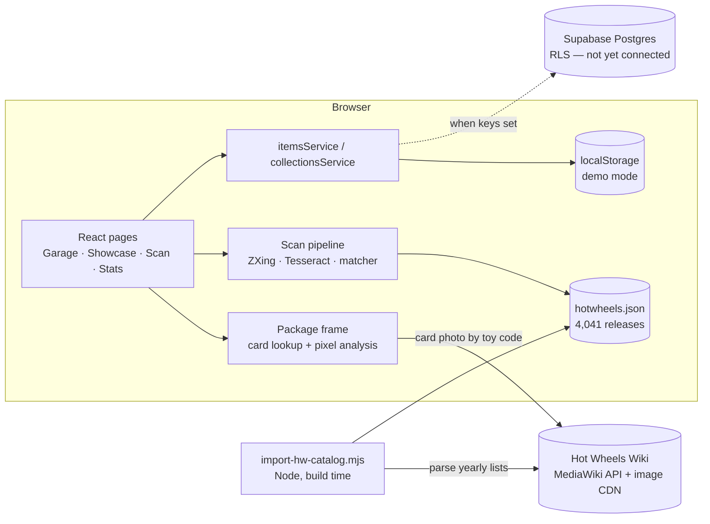

# Architecture

## How it works

Everything runs in the browser. There is no app server in the current setup.

- **Data layer.** Services (`itemsService`, `collectionsService`) talk to Supabase when keys are configured (Postgres with row-level security, so each user only sees their own rows). Without keys they fall back to a local demo database in `localStorage`. The repo also contains an Express + MongoDB backend with auth/user routes, but the web app does not use it.
- **Catalogue.** A Node script (`scripts/import-hw-catalog.mjs`) calls the Hot Wheels Wiki's MediaWiki API, parses the yearly release tables (toy code, collector number, name, variant, series, photo), resolves photo links in batches of 50 and writes a compact JSON file (`public/catalog/hotwheels.json`). The app loads it lazily on the scan page.
- **Scan to Collect.** Photo or camera frame → barcode decode (native `BarcodeDetector` if available, else ZXing) → OCR (Tesseract.js, lazy-loaded, greyscale and contrast pre-processing) → evidence extraction (toy codes with OCR digit repair, collector numbers, series names, years, checksum-valid barcodes) → weighted scoring against the user's garage plus the catalogue → ranked candidates with reasons → the user confirms → saved through the data layer. Photos are never uploaded or stored.
- **Package frame.** One React component renders every car: the real card photo (wiki lookup by toy code), else a pixel-analysed cutout or a photo insert, inside a CSS acrylic case.
- **Garage views.** Shelf (CSS rack), Showcase (three.js scene with the package model) and Grid share one filter set (search, series, mainline/premium, status, sort).

## Diagram

## Key design decisions

- **Static catalogue file instead of a database table.** It works with no backend or keys and is cacheable, at about 132 KB gzipped. Tradeoff: refreshing it means re-running the import script. It's also mainline-only (Premium/Car Culture aren't included).
- **Link wiki photos instead of copying them.** This avoids redistributing images and keeps the repo small. Tradeoff: it depends on the wiki being up, needed a no-referrer workaround for its hotlink placeholder, and needs attribution (wiki text is CC BY-SA).
- **OCR output treated as evidence, not truth.** The matcher scores clues and shows its reasons, returns several candidates when unsure, and never adds a car without confirmation. Tradeoff: more clicks than auto-adding, but no silent wrong entries.
- **Pixel heuristics plus an explicit override, not filename guessing or a paid API.** Free and fast in the browser. Tradeoff: backdrop removal is a heuristic (a white car on white can lose edges), so owners can set the image type per car.
- **One persistent 3D scene with two model "slots".** Switching cars repaints the idle slot's face texture and slides the slots horizontally (460 ms), with rapid clicks queued. Tradeoff: two model copies in memory (geometry shared) instead of rebuilding the scene each time.
- **Security in the database, not the client.** A migration forces `user_id` to the authenticated user and only allows items in collections the user owns (the first schema missed this). Tradeoff: not applied yet, because Supabase isn't connected.
