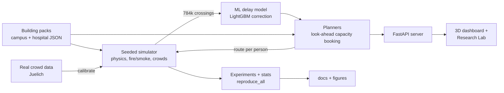

# Architecture

## How it works
1. **Building data.** Buildings are graphs: nodes (rooms, junctions, stairs, exits) and edges (corridor, door, stair, ramp, lift). Two are included: a 6-floor campus (452 nodes) and an oncology hospital (124 nodes), stored as JSON "building packs" in `buildings/`. The pack format lets any floor plan be added.
2. **Simulator** (`evac/simulator.py`, `physics.py`, `hazard.py`). Seeded and headless; runs thousands of evacuations. People walk, queue at doors and stairs, have pre-movement delays and different profiles (walkers, wheelchairs, beds). Fire and smoke can be static or spreading. Parameters are calibrated on real Juelich crowd experiments.
3. **Routing methods** (`evac/routing.py`, `planner.py`). Nearest exit, shortest safe path, reactive rerouting, one-shot capacity booking, and look-ahead re-planning (re-plans every few seconds, books capacity on each edge over time, A* search, 15% switching threshold). Also a genetic algorithm (offline benchmark) and a max-flow lower bound.
4. **ML delay model** (`evac/ml_v3.py`, `delay_model.py`). LightGBM learns a correction to the physics formula for crossing time, trained on simulated crossings. It feeds the planners and the time-to-exit ranges shown on signs.
5. **Experiments and stats** (`evac/runner.py`, `summarize.py`, `final_experiments.py`). Paired seeds, bootstrap CIs, Holm-corrected Wilcoxon tests. `python -m evac.reproduce_all` regenerates every report and figure.
6. **Serving and UI.** `server.py` (FastAPI) exposes `/api/scenarios`, `/api/nodes`, `/api/evacuate`; `research_server.py` adds the Research Lab. Pages: `index.html` (3D dashboard) and `research.html` (methods race side by side, kiosk signs, weak spots).

An earlier first stage (`generate_dataset.py`, `train_model.py`, `ml_evacuation_router.py`) trains a Random Forest on 12,000 synthetic edge-cost samples (test R2 0.98, a fit to the team's own cost formula, not real data) and routes with Dijkstra/A*. The 3D dashboard's `/api/evacuate` still uses it.

## Diagram

## Key design decisions and tradeoffs
- **Coordinate, don't just predict.** Capacity booking changed last-out time by -14.4% vs individually re-routing on the best prediction; ML alone only -0.8% to -3.5%. Tradeoff: more planner complexity, so ML stayed an optional add-on.
- **Hybrid ML (physics x learned factor), not pure ML.** Pure ML had 7.16 s real-data error vs 2.12 s for the hybrid. Tradeoff: less flexible, but safe on geometries it has not seen.
- **Hard "never enter fire" rule plus a safety/speed dial.** Spreading fire, 200 on floor 3: dial 0 gives 320 s / 78 exposed; default gives 309 s / 25 exposed. Speed and exposure are always reported together, since nearest exit is sometimes fastest only by walking through fire.
- **15% switching threshold.** Without it the planner is 4% faster but issues about 3x as many route changes (52 to 135 per run), which real people may not follow.
- **Seeded, paired experiments.** Same people for every method, fully reproducible. Tradeoff: a full re-run takes about 4 hours on 2 cores.
- **A* with cached edge costs in the planner.** Identical results, 2.6x-15.4x faster; the largest synthetic towers still exceed the 5 s re-plan budget.
- **Calibrated vs handbook parameters.** Calibrated is the default; handbook (SFPE) is kept as a conservative option. One IMO test (100 persons through a 1 m door) fails under calibrated values (1.93 persons/s vs 1.33 limit).
