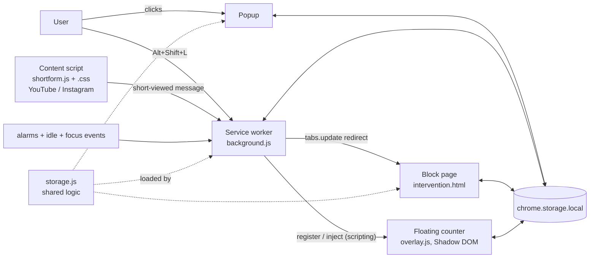

# Lockout: Architecture

## How it works
Lockout is a Manifest V3 extension with no backend. All logic runs in the browser and all state lives in `chrome.storage.local`.

- **`background.js` (service worker):** watches tab navigations, matches each URL against the blocklist, and redirects blocked tabs to the block page. It also runs the time tracker (one-minute alarm plus focus, idle and tab events), registers the floating counter for sites the user granted access to, handles the Alt+Shift+L shortcut, and receives "a Short was viewed" messages.
- **`storage.js` (shared module):** the single source of truth for defaults, lock-in level rules, session start and end, daily stats, streak maths and `toggleCounterOnTab`. It is loaded by the worker (`importScripts`), the popup, the block page and the permission page.
- **`popup.*`:** the toolbar popup: stat screen, level and duration picker, live timer, options. `endgate.js` is the shared "are you sure you want to quit" dialog, whose strictness depends on the level.
- **`intervention.*`:** the block page (calm or "tough love" tone). It reads state, shows streak and time left, and uses the same end gate.
- **`content/shortform.js` + `.css`:** run only on YouTube and Instagram. The CSS hides Shorts shelves, tab and links; the script counts a Short or Reel once it has been on screen for about a second and tells the worker.
- **`content/overlay.js`:** the floating counter, built in a closed Shadow DOM. It is registered for granted sites, or injected on demand with `activeTab`.
- **`grant.*`:** a normal tab that requests optional host access for the always-on counter.

## Key design decisions and tradeoffs

| Decision | Why | Tradeoff |
|---|---|---|
| **Friction levels instead of one hard block.** Chill, Focused (15 s wait), Locked In (typed pledge, no paste, 60 s wait, frozen blocklist), Monk (no early exit, two taps to start). | The goal is to raise the cost of quitting at the moment of impulse. | An extension cannot stop you disabling or uninstalling it. The popup and listing say so and suggest allowing it in Incognito. |
| **Local-only storage, no backend.** | Privacy is the selling point; also nothing to host or pay for. | No sync across devices and no accountability partner features. |
| **Sessions end by timestamp, lazily.** A timed session stores its planned end and is closed the next time the popup, block page or a navigation looks at it, with the end time set to the planned end. | The service worker can be killed, so in-memory timers are unreliable. | The history record is written slightly later than the real end. |
| **Time tracking in segments with a persisted "current visit".** | Survives worker restarts and caps sleep gaps (3 minutes becomes 1 minute). | Time is approximate, not second-exact. |
| **One serial queue for all stats writes in the worker.** | Navigation, tracker and counter messages all read-modify-write the same keys. | Slightly more code than direct writes; a long task delays the next one. |
| **`activeTab` plus a shortcut, with optional per-site host access, instead of `<all_urls>`.** | Smaller permission surface, less review friction, more trust. | The on-demand counter disappears on navigation; always-on needs a one-time grant for the listed sites. |
| **Redirect blocked tabs to an extension page (`tabs.update`).** | Simple and works on any site. | Needs the `tabs` permission to read URLs, and the original page's state is lost. |
| **Hide Shorts with CSS selectors, block Shorts and Reels pages by URL path.** | Keeps the rest of YouTube usable. | The CSS depends on YouTube's markup and can break when it changes. |
| **Counter UI built with DOM calls in a Shadow DOM.** | Works under Trusted Types and isolates it from page CSS. | More verbose than a template string. |
| **No framework or bundler; one shared script, CSS variables for themes.** | Small bundle, easy to load unpacked, no build step. | Globals instead of modules; the CSS file is long (about 1,850 lines). |
