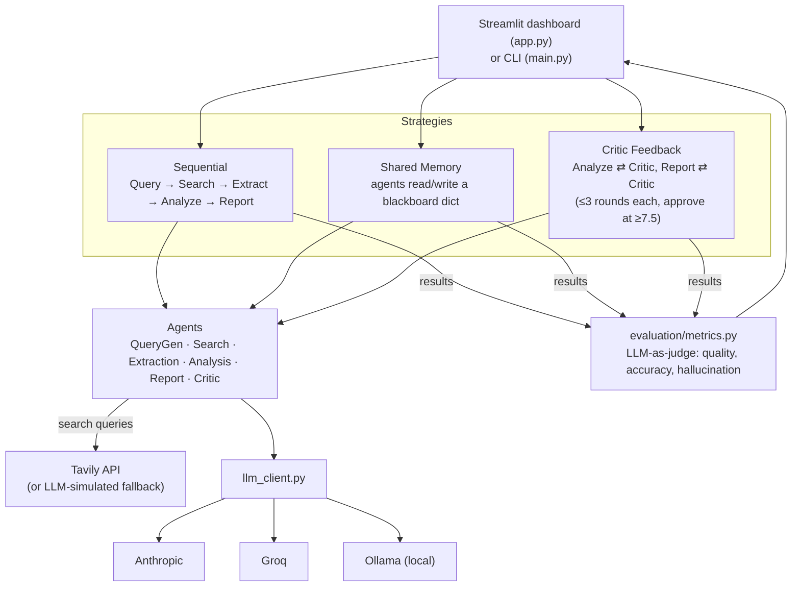

# Multi-Agent Research System: Architecture

## How it works
The project has four layers:

1. **Entry points.** `app.py` is a Streamlit dashboard: pick a topic and strategies, run them, then view charts and reports. `main.py` is a CLI that does the same and can save the results to `results.json`.
2. **Strategies** (`models/`). Each one coordinates the same agents differently and returns a common result dictionary (report, sources, logs, runtime, LLM call count).
3. **Agents** (`agents/`). Each agent is a class with one job and its own system prompt, and all inherit from `BaseAgent`:
   - **QueryGenAgent:** turns the topic into 4 search queries.
   - **SearchAgent:** runs each query on Tavily (3 results each, de-duplicated by URL). With no Tavily key, it asks the LLM to simulate results and prints a warning.
   - **ExtractionAgent:** pulls key facts, statistics, concepts and claims into JSON, from up to 8 sources trimmed to 500 characters each.
   - **AnalysisAgent:** synthesizes findings, patterns and gaps.
   - **ReportAgent:** writes the final Markdown report.
   - **CriticAgent:** scores an analysis or report out of 10 and approves it at 7.5 or above.
4. **LLM access** (`llm_client.py`). One client chosen by `LLM_PROVIDER`: Anthropic SDK, Groq (OpenAI-compatible HTTP API) or Ollama (native `/api/chat`). Every agent and the evaluator call it through the same `messages.create(...)` interface.

After the strategies finish, `evaluation/metrics.py` asks the LLM to judge each report on three measures: quality, factual accuracy against the extracted facts, and hallucination rate. It combines them into a composite score and picks a winner per metric.

## Diagram

## Key design decisions and tradeoffs
- **One set of agents, three coordinators.** The strategies reuse the same agent classes and prompts and differ only in how data flows between them, so a difference in results comes from coordination rather than the prompts. *Tradeoff:* the strategies end up closer than their names suggest. In Shared Memory, only the report step receives the blackboard summary (first 500 characters); the analysis step gets the same input as in Sequential.
- **The critic loops only over analysis and report.** Search and extraction run once, so revisions are bounded: at most 3 rounds per phase, 7.5/10 to pass. *Tradeoff:* the critic can't fix weak sources, and it costs the most. In one measured run it made 22 LLM calls against 12 for the others and took about 3× as long.
- **LLM-as-judge evaluation with the same model.** This needs no labelled dataset and works for any topic. *Tradeoffs:* the judge may favour its own model's style; it only reads the first 800–1,200 characters of each report; and when its JSON can't be parsed it uses fixed defaults (7.0 accuracy, 15% hallucination) rather than failing. Results from one run are noisy.
- **Provider layer that copies the Anthropic interface.** Groq and Ollama are wrapped to look like `client.messages.create(...) → response.content[0].text`, so the agents didn't need rewriting and the original Claude path is unchanged. *Tradeoff:* it supports only plain text in and out, with no streaming or tool use, which is all this project needs.
- **Simulated search fallback.** The pipeline still runs with no Tavily key, with a printed warning on every query. *Tradeoff:* the model makes up studies and URLs, so accuracy and hallucination scores from those runs aren't meaningful.
- **Free-tier-aware Groq client.** It retries per-minute 429s using Groq's `retry-after`, and fails fast on a daily-quota 429. For `gpt-oss` models it sets low reasoning effort and adds 2,048 output tokens of headroom. *Tradeoff:* runs slow down noticeably when the per-minute limit is hit, and models aren't switched automatically mid-run, because that would make the strategies incomparable.
