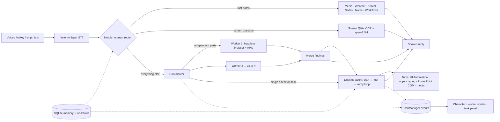

# Novi: Architecture

## How it works
1. **Input:** a wake word ("Novi"), a hotkey, a typed command or a screen snip starts a request. faster-whisper turns speech into text.
2. **Router (`handle_request`):** one entry point for voice, text and the demo script. It checks, in order: saved routines and memory commands → media control → weather → travel → slides → notes → screen questions → the agent. The first six are deterministic fast paths.
3. **Coordinator:** for requests with several independent parts (e.g. "which is hotter, Delhi or Mumbai?"), it asks the model to split the goal into sub-tasks and runs up to 4 **workers** in parallel threads. Each worker has its own headless Chromium plus API tools. A final step merges their findings into one spoken answer, or hands it to the desktop agent if the user asked for an app (e.g. slides).
4. **Desktop agent:** an observe → act → verify loop over Ollama tool calling. It writes a short plan, calls one tool at a time, reads the result, and repeats. Tools cover apps, browser, typing, UI Automation clicks, media, weather, travel, slides, memory and asking the user.
5. **Shared foundations:**
   - `TaskManager`: task state plus an event bus. The UI subscribes; execution code never calls the UI directly.
   - `screen_lock` / `voice_lock`: one worker uses the real mouse and keyboard at a time, and one question goes to the user at a time.
   - `MemoryStore` (SQLite): facts about the user (added to prompts) and workflows (named, reusable steps).
6. **UI (Tkinter, transparent always-on-top windows):**
   - an animated pixel character whose state follows the current task
   - sidekick sprites, one per worker
   - a click-to-open task panel
   - a snip overlay with answer cards
   - a memory and workflow editor

## Diagram

## Key design decisions and tradeoffs
| Decision | Why | Tradeoff |
|---|---|---|
| **Local models only (3B class)** | Privacy (screenshots and clipboard never leave the PC); runs on a 6 GB laptop GPU. | Small models are unreliable on open-ended multi-step tasks; a hosted larger model would be more capable. |
| **Deterministic fast paths before the LLM** | The most common requests (playback, weather, travel, notes, slides) must not depend on the model guessing. | Each fast path is hand-written regex; phrasings outside the patterns fall through to the slower, less reliable agent. |
| **UI Automation instead of pixel coordinates** | Controls are found by name and type, so actions survive window moves and layout changes; no mouse movement is needed. | Some apps expose poor accessibility trees; there is a vision model fallback for reading, but not for clicking. |
| **Web workers in headless browsers; one screen lock for desktop actions** | Workers truly run in parallel without fighting over the real mouse and keyboard. | Desktop tasks can't be parallelised; parallel model calls are limited by GPU memory (Ollama `OLLAMA_NUM_PARALLEL`). |
| **Event bus between execution and UI** | Character, sprites and panel evolve independently from the agent code. | Extra indirection; all Tk work has to be marshalled onto one GUI thread. |
| **Safety by document state, not by "who opened it"** | Windows apps (e.g. Notepad) can restore a user's existing file into a "new" window; checking for a blank document is what actually protects the user. | Some legitimate typing asks for confirmation; Novi-started documents are tracked to avoid extra prompts. |
| **Windows-only APIs (WinRT media controls, Windows OCR, SAPI, COM)** | No extra model downloads; precise state (e.g. "pause" only pauses). | Not portable to macOS or Linux. |
