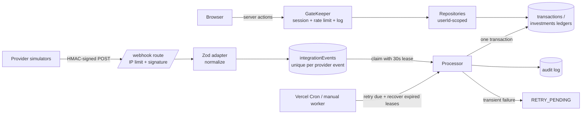

# Architecture

## How it works
- **Browser → Next.js on Vercel.** Pages are server components. Every mutation is a server action. Each page and action calls `requireUser()`, which checks the session in MongoDB. The user id always comes from the session, never from the request.
- **GateKeeper** wraps each action. It does three things: session check, a rate limit per user and action stored in MongoDB (a fixed-window counter with a TTL), and a structured JSON log with a hashed user id. Rejections are stored for monitoring.
- **Repositories** (`transactions`, `goals`, `loans`, `holdings`, `investmentTxns`, …) are the only code that touches the database. Every query filters by `userId`.
- **IdemPay event pipeline** for the simulated providers:
  1. The simulator builds a provider-shaped payload, signs it with HMAC-SHA256 and posts it to `/api/integrations/webhook/[provider]`. This is the same path a real webhook would use.
  2. The route rate-limits by IP, then verifies the signature and a ±5-minute timestamp window.
  3. A per-provider Zod adapter turns the payload into one internal event format.
  4. The event is inserted once; a unique index blocks repeats.
  5. A worker claims the event with a lease. The handler then writes to the existing ledgers, marks the event PROCESSED and adds an audit entry, all in one transaction.
  6. On failure, the event becomes FAILED (a business rule) or RETRY_PENDING (transient, retried with backoff).
- **Retry and recovery worker:** `/api/cron/integrations`, triggered by Vercel Cron and protected by a bearer secret. It can also be run from the event console. It retries due events and recovers events whose lease expired.
- **Monitoring page:** event counts, duplicates prevented, failures and retries, average and p95 processing time, autopay outcomes and GateKeeper rejections, all computed from stored data.

## Key design decisions and tradeoffs
- **MongoDB for idempotency, rate limits and the event queue, not Redis or a message broker.** It keeps one datastore, and Atlas already supports transactions, so the side effect and its "done" marker commit together. The tradeoff: higher latency than Redis, and polling or cron instead of push-based queue consumers. That's acceptable at personal-app volume.
- **The existing ledgers stay the source of truth.** Integration events write through the same repositories as manual entries; there is no parallel ledger. The tradeoff: the handlers have to respect the existing data rules (recurring items, FIFO lots), which made them harder to write.
- **Leases instead of locks.** A crashed serverless function can't release a lock, but a lease expires on its own. The tradeoff: a crashed event waits up to 30 s plus the next worker run before recovery.
- **Business vs transient failures.** Retrying a business-rule failure, such as an oversell, would just fail again. Only transient errors retry. This needs a clear error taxonomy (`UserError` vs everything else).
- **Fail closed for writes, fail open for reads.** If the rate-limit store is unreachable, write actions are refused, but export and search still work. The tradeoff: availability over strictness for low-risk reads.
- **Money as integer paise; quantities as fixed-point integers.** This avoids floating-point rounding. The tradeoff: values have to be converted at the input and display edges.
- **Optimistic concurrency on edits.** A version derived from `updatedAt` is checked in the update filter, so a stale form can't overwrite newer data. The user may then see a "this changed, reload" message.
- **Simulated providers only.** This shows the pipeline honestly without handling real credentials. The tradeoff: the integrations show the engineering, not real data.
