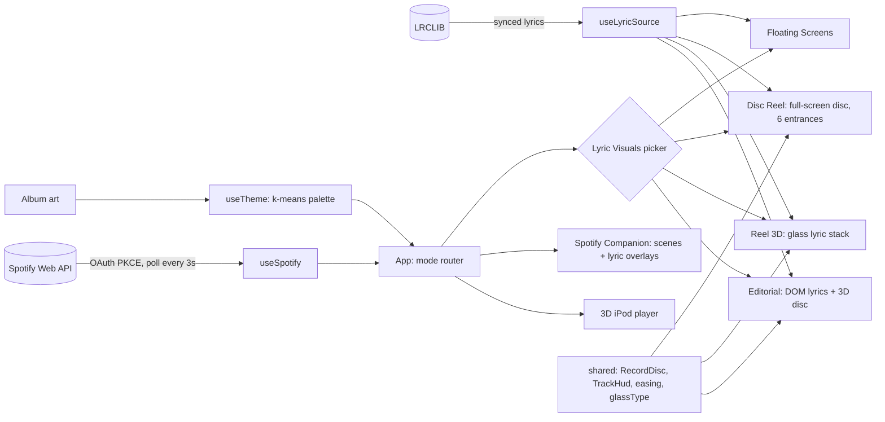

# VibeFlow: architecture

## How it works
VibeFlow is a client-only React app. There is no server of its own.

1. **Sign-in:** `services/spotify.ts` runs OAuth PKCE against Spotify. Tokens are kept in `localStorage`, and a scope-version key forces re-auth if the requested scopes change. Scopes: read currently playing, read playback state, modify playback state.
2. **Playback state:** `hooks/useSpotify.ts` polls the currently-playing endpoint every 3 seconds, refreshes the token when needed, and exposes the track plus play/pause/skip/volume actions.
3. **App shell:** `App.tsx` is a mode router with a header: 3D MP3 Player, Lyric Visuals (a picker), and Spotify Companion. Every mode receives the same Spotify object.
4. **Colour:** `hooks/useTheme.ts` and `services/themeEngine.ts` extract a palette from the album art (k-means) and feed it to the visuals and CSS variables.
5. **Lyrics:** `services/lyrics.ts` fetches time-synced lyrics from LRCLIB. `services/lyricAnalysis.ts` adds a chorus flag (a line that repeats counts as chorus) and provides demo lyrics for when nothing is playing.
6. **Visuals:** four lyric visuals share small modules in `components/shared/` (lyric loading, the spinning record, the track HUD, easing, glass type). The 3D iPod and the Companion scenes are separate modes.
7. **Hosting:** `npm run build:web` produces a static site for Vercel (`vercel.json` rewrites everything to `/`). The desktop build uses electron-vite (`electron/main`, `electron/preload`).

## Diagram

## Key design decisions and tradeoffs
| Decision | Why | Tradeoff |
| --- | --- | --- |
| Client-only app with PKCE | No backend to run or host; works as a static site and inside Electron | The Spotify client ID lives in a source file; the redirect URI must be registered for each domain |
| Poll every 3 s and interpolate progress between polls | Lyrics must change on the beat of the song, not on the poll | Position can drift up to one poll interval after a seek or pause until the next poll |
| Chorus = repeated lines | Cheap, language-agnostic way to give the visuals a quiet baseline and a peak | A heuristic; it can miss choruses with small lyric changes. TODO: accuracy not measured |
| Editorial mode uses DOM text, not 3D text | Crisp, accessible, easy to animate; one small 3D canvas for the record | The 3D visuals keep glass text separately, so there are two text systems |
| Glass type built from font outlines (opentype.js) instead of ready-made typeface JSON | Any TrueType font works and the bevel is controllable | Needs glyph coverage; the default font is Latin only. Geometry is built at runtime |
| Slightly frosted glass | Fully clear glass was unreadable over coloured backdrops | Less "pure glass" than the reference |
| Cut effects after review (shake, flashes, per-line colour changes) | Everything animating at once had no hierarchy and felt unfinished | Fewer "wow" moments; effects are now reserved for choruses |
| Shared modules for record, lyric loading, HUD, easing | Four visuals were duplicating the same code | More files to navigate |
| Per-visual dependency on the same Spotify object | Any mode can be added without touching auth | None found yet |
